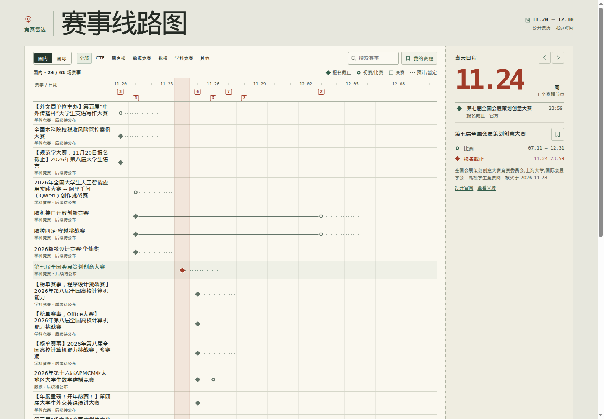
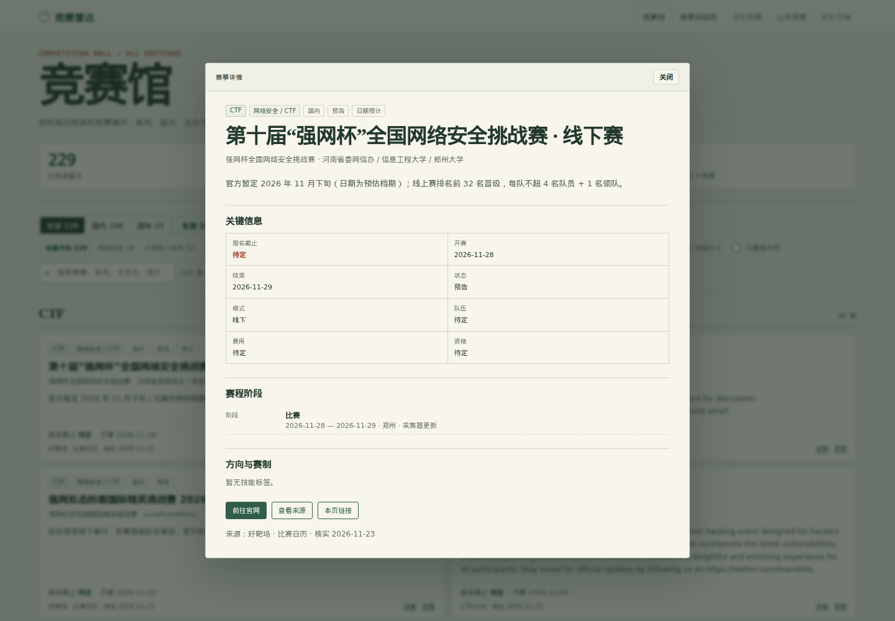
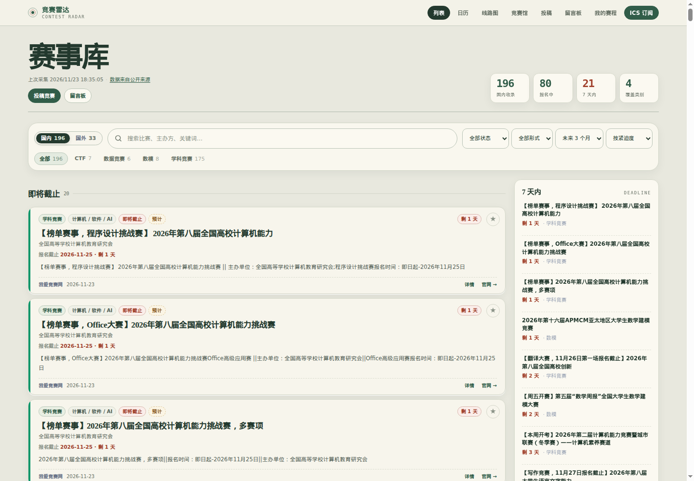

# 竞赛雷达 · Contest Radar

聚合国内/国外 CTF、黑客松、数据竞赛、数学建模与学科竞赛，按截止/开赛时间排序，支持 ICS 日历订阅、浏览器本地收藏和本地匹配。

> **致谢与二次开发声明**
>
> 本项目基于 [ZiChuanLan/freebie-radar](https://github.com/ZiChuanLan/freebie-radar)（MIT License）的产品思路与工程模式二次开发，方向改为竞赛情报与公共赛历。
> 上游版权归原作者所有；本项目不是 freebie-radar 官方项目，也不代表上游背书。
> 完整说明见 [ATTRIBUTION.md](ATTRIBUTION.md)，许可证见 [LICENSE](LICENSE)。

## 预览

赛事线路图（`/`，默认首页）：



竞赛馆（`/hall`，收录全部届次与简介）：



卡片列表（`/list`，保留原卡片视图）：



## 功能概览

- 国内 / 国外分区，默认国内
- 赛事系列 → 届次 → 阶段
- 采集 → 待审核 → 合并/发布 → 公开变更
- 公开 v1 API、公共 ICS、阶段级 VALARM
- 赛事线路图视图：按阶段时间轴浏览，移动端降级为列表
- 竞赛方向分类：网络安全 / 计算机 / 数据 / 数学 / 电子 / 工程 / 理科 / 设计 / 商科 / 外语 / 人文 / 体育
- 内容类型过滤：竞赛 / 志愿者 / 会议 / 课程 / 活动
- 本地收藏、我的赛程、本地画像、匹配评分
- 单管理员令牌，无账号/队伍/服务端履历
- SQLite 每日备份、sitemap、robots

## 文档

- [方向分类与内容类型审计](docs/classification-audit.md)
- [匿名版需求文档](docs/requirements-v0.2-anon.md)
- [匿名版架构设计](docs/architecture-v0.2-anon.md)
- [v0.1 → v0.2-anon 变更说明](docs/changes-v0.1-to-v0.2-anon.md)

## 地区分区

页面顶层按 **国内 / 国外** 分区，**默认国内**；每个地区内再按 CTF / 黑客松 / 数据竞赛 / 数模 / 学科竞赛分类。

- **国内**：`region=cn`。来源：CTFtime 中国区筛选、攻防世界 / XCTF 官方赛事 API、CTFHub、好靶场比赛日历、我爱竞赛网、人工种子（强网杯 / 网鼎杯 / CISCN / XCTF / 数模 / 学科）。
- **国外**：`region=intl`。CTF 只保留 CTFtime `weight >= 10` 的高权重赛事，过滤小比赛，降低冗余；黑客松/数据竞赛/数模来自 Devpost / DrivenData / COMAP。
- CTF 分类键仍为 `ctf-cn` / `ctf-intl`，UI 统一显示为「CTF」，由地区切换控制。

国内 CTF 的检索算法：

1. **多源**：官方平台优先（攻防世界），聚合站补充（好靶场、CTFHub），CTFtime 只取中国相关条目。
2. **区域判定**：中国城市/主办方/中文标题/`.cn` 域名/已知赛事别名；不用正文里提到 China 这种弱信号，避免把国外赛误判。
3. **实体归一**：`强网杯 / Qiangwang / QWB`、`网鼎杯 / Wangding`、`CISCN / 全国大学生信息安全竞赛`、`XCTF` 等别名 + 年份生成同一个 key，跨源合并，不重复展示。
4. **相关性过滤**：只保留 CTF / 夺旗 / AWD / 攻防 / 解题 / 渗透类；纯理论赛、行业技能赛不进国内 CTF。
5. **可信度**：官方赛事标「官方」，好靶场档期标「预计」，人工种子标「待核对」；日期以官网为准。

## 数据源

| 源 | 类型 | 方式 |
|---|---|---|
| CTFtime | 国际 CTF / 中国区 CTF | 官方 API，国际按 weight 过滤 |
| 攻防世界 / XCTF | 国内 CTF/网安赛 | 官方公开事件 API |
| CTFHub | 国内 CTF | 公开赛事 API |
| 好靶场 | 国内 CTF 日历 | 页面解析 |
| 赛氪 | 学科竞赛 / 英语 / 数模 / AI | 公开 PC API |
| 高校学生竞赛网 | 国赛 / 学科竞赛 | 公开竞赛列表 API |
| Devpost | 黑客松 | 页面 JSON-LD |
| 我爱竞赛网 | 学科竞赛 | GBK 页面解析 |
| DrivenData | 数据竞赛 | 页面解析 |
| COMAP / MCM-ICM | 数模 | 页面解析 |
| 人工种子 | 数模 / 学科 / 国内 CTF | 官方链接，日期待公布 |

## 新增来源（2026-11）

- **赛氪**：`apiv4buffer.saikr.com/api/pc/contest/lists`，按 `contest_id` 去重，只保留未结束赛事，最多 120 条。
- **高校学生竞赛网**：`www.gxxsjs.com/prod-api/home/competition/page`，取国赛列表，最多 100 条。
- 两个来源默认进入 `ingest_items` 待审核区，不直接发布。
- `/admin` 待审核页支持按来源筛选；选中来源后可「采纳该来源全部」。
  该操作会立即公开没有匹配到已有届次的新赛事，使用前会二次确认。
- 精确匹配已有 `legacy_key` / `external_ref` 的记录仍会自动合并，不新建重复赛事。

## 赛事线路图与竞赛馆

- `/`：赛事线路图，默认首页
  - 桌面端为阶段时间轴：报名截止 / 初赛或比赛 / 决赛
  - 移动端自动降级为按截止日期排列的列表
  - 支持地区、类别、搜索、我的赛程
  - 点击阶段查看赛事详情、来源和官网链接
- `/hall`：竞赛馆
  - 收录全部已发布届次
  - 按类别分组，附系列、主办方、简介、报名截止和官网
  - 默认展示全部地区，支持搜索和类别/地区筛选
- `/list`：原卡片列表
- `/timeline`：线路图兼容入口，与 `/` 相同
- 数据均来自 `/api/v1/editions`

## 运行

```bash
cp .env.example .env
# 修改 .env 中的 ADMIN_TOKEN；不要提交 .env
docker compose up -d --build
curl http://127.0.0.1:8789/api/health
```

本地开发：

```bash
npm install   # 当前没有运行时依赖，可跳过
npm test
ADMIN_TOKEN=dev-token AUTO_REFRESH=0 DB_PATH=/tmp/contest.db npm start
```

数据每 6 小时自动刷新。手动刷新（需要 `.env` 里的 `ADMIN_TOKEN`）：

```bash
curl -X POST -H "x-admin-token: $ADMIN_TOKEN" http://127.0.0.1:8789/api/refresh
```

## 接口

- `GET /api/data` — 全部比赛 + 统计 + 数据源状态
- `GET /api/health` — 健康检查
- `GET /calendar.ics?region=cn|intl` — 按地区导出 ICS（含报名截止提醒）
- `POST /api/refresh` — 手动刷新（管理员令牌）

## 说明

- 日期有三种置信度：`官方`（结构化源）/ `预计`（页面文本/第三方日历）/ `待核对`（人工种子）。
- 聚合站仅做发现，报名与截止时间以各赛事官网为准。
- 数据竞赛目前只接 DrivenData；Kaggle 需要登录，天池 / DataFountain 可后续补。
- 国内 CTF 的未公布赛事用人工种子占位，官方通告后再由采集器自动覆盖。

## v0.2-anon（第一步已实现）

当前版本在原有扁平 `competitions` 表旁边新增了匿名版数据模型，并保留旧表只读兼容：

- `event_series` → `event_editions` → `event_stages`
- `tags` / `edition_tags`
- `edition_changes` / `admin_audit`
- `ingest_items` 待审核区
- `sources` 增加 `enabled`

启动时会自动把旧 `competitions` 表迁移成系列/届次/阶段（`legacy_key` 唯一键，可重复执行）。旧表暂不删除，方便回滚。

### 新接口

公开接口（无需登录）：

- `GET /api/v1/health`
- `GET /api/v1/taxonomy`
- `GET /api/v1/editions?region=cn&category=ctf&status=open&q=...&page=1&size=20`
- `GET /api/v1/editions?field=software&tech=1`（方向 / 技术向过滤）
- `GET /api/v1/editions/{id}`
- `GET /api/v1/stats`
- `GET /api/v1/changes`
- `GET /api/v1/ical/all.ics`
- `GET /api/v1/ical/region/{cn|intl}.ics`
- `GET /api/v1/ical/category/{category}.ics`

管理接口（`X-Admin-Token`）：

- `GET /api/v1/admin/overview`
- `GET /api/v1/admin/ingest?state=pending`
- `POST /api/v1/admin/ingest/{id}/accept`（可带 `{"edition_id": 123}` 合并）
- `POST /api/v1/admin/ingest/{id}/reject`
- `GET/POST /api/v1/admin/editions`
- `GET/PATCH/DELETE /api/v1/admin/editions/{id}`
- `POST /api/v1/admin/editions/{id}/stages`
- `PATCH/DELETE /api/v1/admin/stages/{id}`
- `GET/POST /api/v1/admin/series`
- `GET/POST /api/v1/admin/tags`
- `GET /api/v1/admin/sources`
- `POST /api/v1/admin/refresh`
- `POST /api/v1/admin/backup`
- `GET /api/v1/admin/changes`
- `GET /api/v1/admin/audit`

管理页：`/admin`，令牌只存 `sessionStorage`。

### 采集与审核

采集器仍会写旧 `competitions` 表（`LEGACY_SYNC=1`，迁移期兼容），同时把候选写入 `ingest_items`；待审核记录不会进入公开列表，必须在 `/admin` 采纳后才发布。采纳时可以：

- 新建系列/届次/阶段；
- 合并到已有届次（补充阶段、标签、外部引用）。

`AUTO_REFRESH=0` 可关闭启动采集，测试时使用。

### 测试

```bash
npm test
```

覆盖旧数据迁移、状态推导、待审核采纳/合并、阶段时间修改与 ICS SEQUENCE、管理员认证、公开列表/详情、备份可恢复性。

## 公开前端已切到 v1

- 首页默认国内、未来 3 个月；可切「全部时间」。
- 列表/日历数据来自 `/api/v1/editions`，不再是 `/api/data`。
- 详情展示系列、阶段、时间状态、核实时间。
- 卡片右上角 ★ 收藏；「我的赛程」只读 `localStorage`。
- 支持导出收藏 ICS、导出/导入本地 JSON、清除本地数据。
- URL 保存地区、类别、状态、形式、时间、排序、搜索词和视图，刷新可复现。
- 旧 `/api/data` 仍保留兼容，但首页已不再依赖它。

`/api/v1/editions` 新增内部前端参数：

- `all_dates=1`：不做默认 90 天过滤
- `include_unknown=1`：保留没有日期的待定赛事

## 本地画像与匹配（P1）

- 「我的赛程」内分：收藏赛程 / 本地画像 / 匹配结果。
- 画像存 `cr.profile`：学历、年级、方向自评 0–5、目标、是否只参加线上、不可用时间段。
- 匹配分在浏览器计算：方向 40 分、难度 30 分、目标 30 分。
- 硬条件（只线上但赛事线下、不可用时间冲突、资格要求研究生等）标灰并给出理由，不隐藏。
- 画像不参与公共排序，不上传服务器；导出/导入 JSON 会一并携带画像。

## 系列 / 标签管理

`/admin` 新增「系列 / 标签」页：

- 系列新建、编辑、删除（系列下仍有届次时拒绝删除）
- 标签按方向/赛制添加、查看使用次数、删除未使用标签

## 待审核去重

- 待审核列表会给每条记录计算 `suggested_edition`：
  - 先匹配 `legacy_key`（旧表迁移的同一赛事）
  - 再匹配 `external_ref` 里记录过的来源 ID
- 有匹配时，单条「采纳」会自动合并到已有届次，不会新建重复赛事。
- 管理页显示「将合并 #ID 标题」，按钮改为「采纳并合并 #ID」。
- 「合并全部精确匹配」只处理能匹配到已有届次的 pending 记录；新赛事不会自动发布。

## 公开变更页、SEO 与自动备份

- `/changes`：公开变更记录，展示新增、时间调整、延期/取消。
- `/sitemap.xml`：首页、变更页和全部已发布届次详情深链。
- `/robots.txt`：允许抓取公开页，禁止 `/admin`。
- 每日 03:00（容器 `TZ=Asia/Shanghai`）自动 SQLite 备份。
- 备份保留 `BACKUP_RETENTION_DAYS` 天（默认 14），只清理 `contest-*.db`。
- `AUTO_BACKUP=0` 可关闭；手动备份仍可用 `/api/v1/admin/backup`。


## 项目结构

```text
server.js / db.js / schema.js      # HTTP 入口、SQLite、schema 与迁移
events.js                           # 系列/届次/阶段、状态推导、公开查询
ingest.js                           # 采集候选、去重、审核、发布
public-api.js / admin-api.js        # 公开 v1 API、管理 API
calendar-v2.js                      # 阶段化 ICS
collectors/                         # 各来源采集器
public/                             # 公开站、管理页、变更页
docs/                               # 需求、架构、变更说明
test/                               # node:test 测试
```

## 许可

MIT License。上游 freebie-radar 的版权声明保留在 [LICENSE](LICENSE)。
